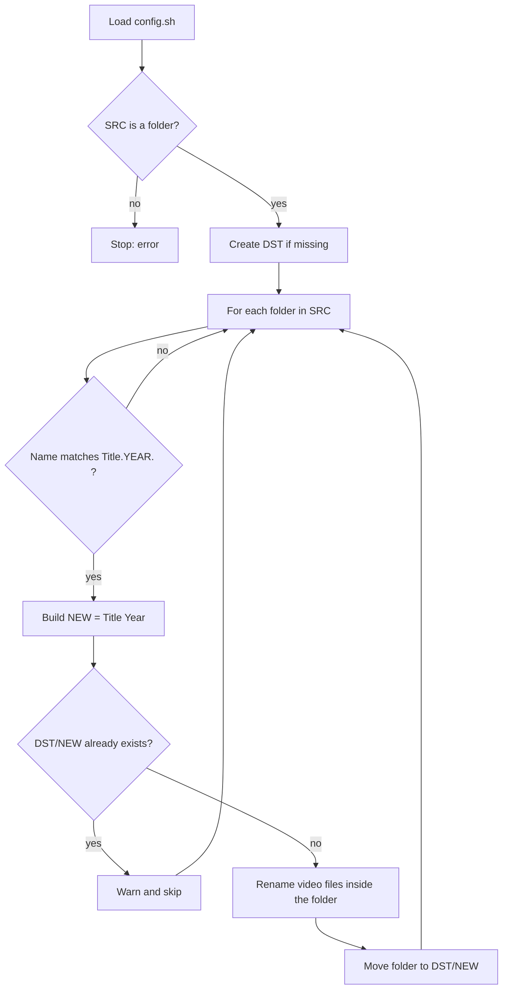

# movies.sh

A Bash script that turns messy movie download folders into a clean, media-server-friendly library (Jellyfin, Plex, Emby, TinyMediaManager).

```
Before:  SAB/French.Kiss.1995.1080p.BluRay.H264.AAC/French.Kiss.1995.1080p.BluRay.H264.AAC.mp4
After:   SAB/Movies/French Kiss (1995)/French Kiss (1995).mp4
```

Media servers match movies against online databases using the `Title (Year)` convention. Release names like `French.Kiss.1995.1080p.BluRay.H264.AAC` often cause wrong or missing matches. This script fixes the naming of both the folder and the video file in one pass.

---

## Features

- Renames **folders** to `Title (Year)` and **video files** to `Title (Year).ext`
- Moves each renamed folder into a destination library folder
- Handles `.mp4`, `.mkv`, `.avi`, case-insensitive (`.MKV` works)
- Skips anything that isn't named like a movie (Music, Books, TV Shows...)
- Never overwrites: duplicates are reported and left for you to decide
- Safe to run repeatedly: a second run changes nothing
- Private paths live in a separate, git-ignored config file

---

## Requirements

- **Bash 4+** (uses `${var,,}` for lowercase). Default on Linux. macOS ships Bash 3.2, so install a newer Bash first.
- Standard tools: `basename`, `tr`, `mv`, `mkdir`

---

## Quick start

```bash
git clone https://github.com/VuZky/homelab-media-server.git
cd homelab-media-server/scripts/movies

cp config.example.sh config.sh   # create your private config
nano config.sh                   # set SRC and DST to your own folders
chmod +x movies.sh

./movies.sh
```

### Configuration

`config.sh` holds the only two values that differ from one machine to another:

| Variable | Meaning | Behavior if missing |
|---|---|---|
| `SRC` | Folder containing the downloaded movie folders | Script stops with an error (it must already exist) |
| `DST` | Library folder where renamed movies are moved | Created automatically |

```bash
# config.example.sh
SRC="$HOME/Downloads/SAB"
DST="$HOME/Downloads/SAB/Movies"
```

`config.sh` is listed in `.gitignore`, so your real paths are never committed. The script finds it next to itself, so you can run it from any folder.

---

## How it works



The script runs in three phases.

### Phase 1: Configuration

Loads `SRC` and `DST` from `config.sh`, then sets the matching rules:

```bash
shopt -s nocaseglob                          # *.mkv also matches .MKV
re='^([A-Za-z0-9._& -]+)\.([0-9]{4})\.'      # Title.YEAR.
#     └──── [1] title ────┘  └[2] year┘
```

### Phase 2: Safety checks

Rule: checks that run **once**, before the loop, use `exit`. Checks that run **for each movie**, inside the loop, use `continue`.

| # | Risk | Why it matters | Solution |
|---|---|---|---|
| 0 | Config file missing | `SRC` and `DST` would be empty, giving confusing errors or wrong paths | Check `config.sh` exists, else stop with instructions |
| 1 | `SRC` missing or mistyped | The script would quietly find nothing and look successful | `[[ -d "$SRC" ]] \|\| exit 1` |
| 2 | `DST` missing | `mv` would **rename** the first movie folder to `Movies` instead of moving it | `mkdir -p "$DST" \|\| exit 1` |
| 3 | Non-movie folders | `SRC` may also contain Music, Books, TV Shows, `Movies` itself | Skip any folder not matching `Title.YEAR.` |
| 4 | Duplicate | Moving a folder onto an existing one **nests** it inside (`Movies/Witness (1985)/Witness (1985)/`) | If `DST/NEW` exists, warn and skip. You choose which version to keep |
| 5 | Already renamed file | `mv` onto the same name throws an error on every run | Skip if the file already has its target name |
| 6 | Two videos in one folder | Movie + sample would get the same name, and the second would overwrite the first | `mv -n` (no-clobber): the second file keeps its original name |

### Phase 3: Processing

Two nested loops:

```
Movies/French Kiss (1995)/French Kiss (1995).mp4
       └── outer loop ──┘ └──── inner loop ────┘
```

- **Outer loop**, one round per folder: match the name, build `Title (Year)`, check for duplicates, move the folder.
- **Inner loop**, one round per video file in that folder: rename it to `Title (Year).ext`.

### One round, step by step

```
$m      = $SRC/French.Kiss.1995.1080p.BluRay.H264.AAC/
name    = French.Kiss.1995.1080p.BluRay.H264.AAC        (basename)
[0]     = French.Kiss.1995.                             (whole regex match)
[1]     = French.Kiss                                   (title)
[2]     = 1995                                          (year)
TITLE   = French Kiss                                   (dots → spaces)
NEW     = French Kiss (1995)
check   = $DST/French Kiss (1995)                       (exists? → skip)
$e      = .../French.Kiss.1995.1080p.BluRay.H264.AAC.mp4
EXT     = mp4
TARGET  = .../French Kiss (1995).mp4
result  → $DST/French Kiss (1995)/French Kiss (1995).mp4
```

A non-movie folder: `$SRC/Music/` → `name = Music` → no match → skipped.

The regex is greedy, so titles containing a number still work:
`Blade.Runner.2049.2017.1080p` → title `Blade Runner 2049`, year `2017`.

---

## Testing safely

1. **Build a fake library in `/tmp`** and point `config.sh` at it temporarily:
   ```bash
   mkdir -p /tmp/SAB/French.Kiss.1995.1080p.BluRay.H264.AAC
   touch    /tmp/SAB/French.Kiss.1995.1080p.BluRay.H264.AAC/French.Kiss.1995.1080p.BluRay.H264.AAC.mp4
   mkdir -p /tmp/SAB/Blade.Runner.2049.2017.1080p.WEB
   touch    /tmp/SAB/Blade.Runner.2049.2017.1080p.WEB/Blade.Runner.2049.2017.1080p.WEB.MKV
   mkdir -p /tmp/SAB/Music
   ```
   Include hard cases: a duplicate, a title containing a number, an extra word (`REMASTERED`), an uppercase extension, a non-movie folder.
2. **Dry run:** put `echo` in front of both `mv` commands to print what would happen without changing anything.
3. **Run twice:** the second run must change nothing.
4. **On real data:** back up first (compare `du -sh` of the source with `df -h` free space), dry run, read the output, remove the `echo`, then run.
5. **Check the result:** `tree -L 2 "$DST"`

---

## Known limitations and future improvements

- **Separators:** the year must be surrounded by dots (`Title.2001.`). Names using `_` or spaces as separators (`Amelie_2001_1080p`) are skipped.
- **Characters:** titles with apostrophes or accented letters don't match the regex and are skipped.
- **Subtitles:** external `.srt` files are not renamed, so media servers may no longer link them to the renamed video.
- **Skipped folders are silent:** a folder that doesn't match produces no message. A skip message and an end-of-run summary would help.
- **Dry run is manual:** adding `echo` by hand could be replaced by a built-in `--apply` flag (dry run by default).
- **Title cleanup** uses `echo | tr`; it could be done with parameter expansion (`${var//./ }`) without a pipe.

Running the script by hand, rather than automatically after each download, is a deliberate choice: downloads arrive at irregular times, and formatting the whole batch takes about a second.

---

## Project structure

```
.
├── movies.sh            # the script
├── config.example.sh    # template: copy to config.sh
├── config.sh            # your private paths (git-ignored)
├── .gitignore
└── README.md
```

---

<details>
<summary><strong>Bash concepts used in this script</strong></summary>

### Regex with `[[ =~ ]]` and `BASH_REMATCH`

`[[ string =~ $re ]]` does two things:

1. **Tests** whether the string matches (true/false, works with `&&` and `||`)
2. **Extracts** each `( )` group into the `BASH_REMATCH` array: `[0]` is the whole match, `[1]` the first group, `[2]` the second

`grep` can only test; `[[ =~ ]]` can also extract, which is needed to build new names.

- Don't quote `$re` inside `[[ =~ $re ]]`: quoted, it's treated as plain text, not a regex.
- Store the regex in a variable (`re='...'`) to avoid quoting problems.
- Inside `[ ]`, put `-` first or last. Between two characters it creates a range (`[.-_]` means everything from `.` to `_`).

| Piece | Meaning |
|---|---|
| `^` | start of the string |
| `[A-Za-z0-9._& -]` | one character from this set |
| `+` | one or more of the previous |
| `\.` | a literal dot (a bare `.` means any character) |
| `[0-9]{4}` | exactly 4 digits |
| `( )` | capture this part into `BASH_REMATCH` |

**Greedy matching:** `+` grabs as much as possible, then gives back only what's needed, so the *last* valid year wins.

**Testing a regex:**
```bash
ls | grep -E  "regex"   # what matches
ls | grep -vE "regex"   # what doesn't (check nothing important is missed)
```

### Parameter expansion

Cut a variable without running a command:

| Expression | On `a.b.mp4` | Meaning |
|---|---|---|
| `${e#*.}` | `b.mp4` | remove from start, shortest match |
| `${e##*.}` | `mp4` | remove from start, longest match (the extension) |
| `${e%.*}` | `a.b` | remove from end, shortest match (name without extension) |
| `${e%/}` | | remove a trailing `/` |
| `${e,,}` | | lowercase (`MKV` → `mkv`) |

### Loading the config: `source`

```bash
CONFIG="$(dirname "$0")/config.sh"   # config sits next to the script, wherever you run it from
[[ -f "$CONFIG" ]] || { echo "Missing config: $CONFIG (copy config.example.sh)"; exit 1; }
source "$CONFIG"                     # runs config.sh inside this script, so SRC and DST exist here
```

`./config.sh` would run in a separate process, and its variables would disappear when it ended. `source` runs it in the current process, so the variables stay.

### Globs

```bash
"$SRC"/*/               # only folders (each value ends with /)
"$m"*.{mp4,avi,mkv}     # video files in this folder
```

- Quote the variable, keep the pattern outside the quotes.
- No spaces inside `{ }`.
- If nothing matches, Bash leaves the pattern as literal text, so catch it with `[[ -f "$e" ]] || continue`.

### Tests and control flow

| Syntax | Meaning |
|---|---|
| `-e` / `-f` / `-d` | exists / is a file / is a folder |
| `a && b` | run `b` if `a` succeeded |
| `a \|\| b` | run `b` if `a` failed |
| `{ a; b; }` | group commands (spaces and `;` before `}` required) |
| `continue` | skip to the next loop round |
| `exit 1` | stop the whole script with a failure code |

### `mv` behaviors (test in `/tmp`)

- Destination folder missing → **renames** instead of moving
- File onto an existing file → **overwrites silently** (`mv -n` prevents it)
- Folder onto an existing folder → goes **inside** it
- `mv` never creates `Name (2)` by itself

</details>
